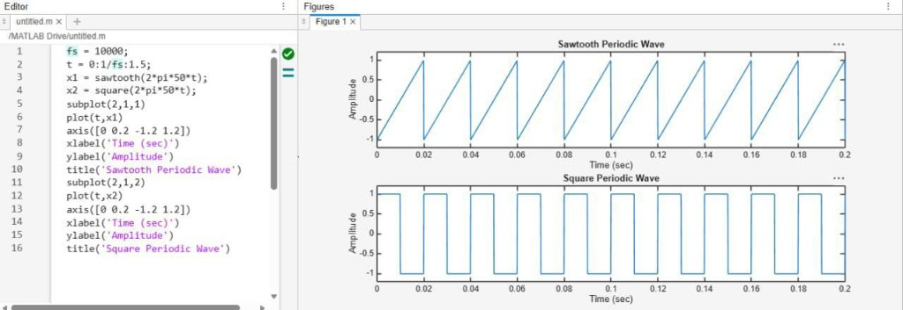
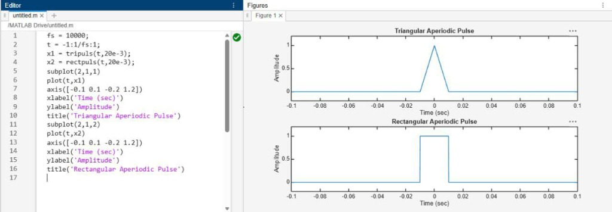
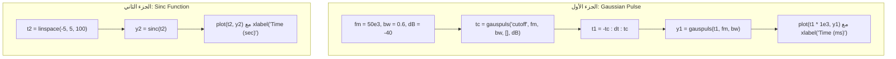
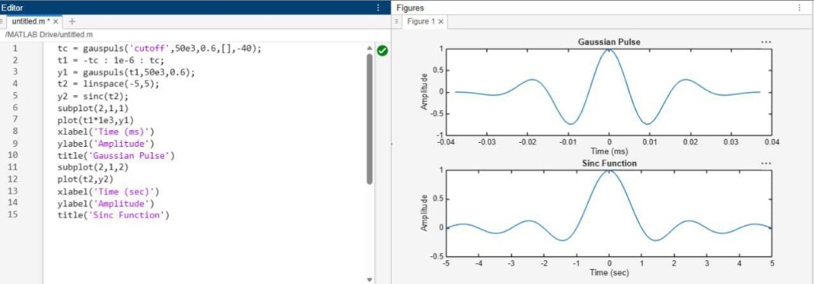

# الدليل الشامل والمرئي لامتحان مختبر منظومات الاتصالات المتنقلة
### Mobile Communication System Laboratory – Practical Masterclass Guide

---

## 📌 1. فكرة وفلسفة الامتحان العملي وكيف تضمن الدرجة الكاملة؟

يتبع الامتحان في قسم **هندسة تقنيات الحاسوب (المرحلة الرابعة)** نموذجاً موحداً وذكياً صُمم لاختبار فهم الطالب الرياضي والبرمجي بدقة:


### 🎯 القواعد الذهبية للامتحان:
1. **الورقة أولاً:** املأ جميع الفراغات في ورقة الإجابة بالقلم الجاف أو الرصاص قبل الانتقال إلى جهاز الحاسوب.
2. **عدم تغيير أسماء الدوال:** إياك أن تغير أسماء الدوال الرياضية المكتوبة في القالب (مثل `sawtooth`, `square`, `tripuls`, `rectpuls`, `gauspuls`, `sinc`).
3. **فصل الترددات:** لا تخلط أبداً بين تردد أخذ العينات $f_s$ وتردد الإشارة $f_m$.
4. **عناصر الرسم الإلزامية:** كل رسمة يجب أن تحتوي على:
   - تقسيم الشاشة: `subplot(r, c, p)`
   - رسم المنحنى: `plot(t, x)`
   - تسمية المحور السيني: `xlabel('...')`
   - تسمية المحور الصادي: `ylabel('Amplitude')`
   - عنوان الرسمة: `title('...')`
   - شبكة الرسم: `grid on`

---

## ⚡ 2. دليل تحويل الوحدات والأسس العلمية (أهم جزء في الامتحان)

معظم درجات الطلاب تُفقد ليس في كود MATLAB، بل في **كتابة الأسس والوحدات بطريقة غير صحيحة**!

### أ) جدول ترددات الإشارة وأخذ العينات (التردد بالهرتز $\text{Hz}$):
| الوحدة في الورقة | الرمز | المعامل الرياضي | طريقة كتابتها داخل MATLAB | مثال واقعي |
| :--- | :---: | :---: | :--- | :--- |
| **كيلو هرتز** (Kilo) | $\text{k}$ | $10^3$ | `1e3` أو ضرب مباشر `*10^3` | $50\text{ kHz} \longrightarrow$ `50e3` أو `50000` |
| **ميغا هرتز** (Mega) | $\text{M}$ | $10^6$ | `1e6` أو `10^6` | $2\text{ MHz} \longrightarrow$ `2e6` |
| **غيغا هرتز** (Giga) | $\text{G}$ | $10^9$ | `1e9` | $1.5\text{ GHz} \longrightarrow$ `1.5e9` |
| **تيرا هرتز** (Tera) | $\text{T}$ | $10^{12}$ | `1e12` | $0.8\text{ THz} \longrightarrow$ `0.8e12` |

---

### ب) جدول وحدات الزمن وعرض النبضة (الزمن بالثواني $\text{s}$):
| الوحدة في الورقة | الرمز | المعامل الرياضي | طريقة كتابتها داخل MATLAB | مثال واقعي |
| :--- | :---: | :---: | :--- | :--- |
| **ملي ثانية** (Milli) | $\text{m}$ | $10^{-3}$ | `1e-3` أو `0.001` | $20\text{ ms} \longrightarrow$ `20e-3` أو `0.020` |
| **مايكرو ثانية** (Micro) | $\mu$ | $10^{-6}$ | `1e-6` | $1\text{ }\mu\text{s} \longrightarrow$ `1e-6` |
| **نانو ثانية** (Nano) | $\text{n}$ | $10^{-9}$ | `1e-9` | $5\text{ ns} \longrightarrow$ `5e-9` |
| **بيكو ثانية** (Pico) | $\text{p}$ | $10^{-12}$ | `1e-12` | $1\text{ ps} \longrightarrow$ `1e-12` |

---

### 🚨 فخ مقياس الرسم (The Time Display Scale Trap):
في **التجربة الثالثة (Gaussian Pulse)**، يتم حساب متجه الزمن $t_1$ بالثواني ويكون صغيراً جداً (مثلاً $0.00004\text{ s}$).
إذا طلب الأستاذ عرض المحور بوحدة معينة:

> [!CAUTION]
> **خطأ كارثي يقع فيه أغلب الطلاب:**
> عند الرغبة في عرض محور الزمن بوحدة الملي ثانية ($\text{ms}$)، يقوم الطالب بكتابة `plot(t1 * 1e-3, y1)`. هذا خطأ فادح!
> الصحيح هو الضرب في **`1e3`** (موجب 1000):
> $$\text{plot}(t_1 \times 10^3, y_1) \quad \text{مع} \quad \text{xlabel('Time (ms)')}$$
> **التفسير:** $0.001\text{ s} \times 1000 = 1\text{ ms}$. الضرب بالأس الموجب هو الذي يحول القيمة الصغيرة إلى رقم مقروء على المحور!

| الوحدة المطلوبة في المحور | المعامل المضروب بـ `t1` في دالة `plot` | كود محور الزمن `xlabel` |
| :---: | :---: | :--- |
| **الثواني** (Seconds) | `1` | `xlabel('Time (sec)')` |
| **الملي ثانية** (Milliseconds) | **`1e3`** | `xlabel('Time (ms)')` |
| **المايكرو ثانية** (Microseconds) | **`1e6`** | `xlabel('Time (\mu s)')` |
| **النانو ثانية** (Nanoseconds) | **`1e9`** | `xlabel('Time (ns)')` |

---

## 🌊 3. التجربة الأولى: الإشارات الدورية (Periodic Waveforms)

تختص هذه التجربة بتوليد موجات متكررة دورياً، ويُطلب منك إما موجة **سن المنشار (Sawtooth)** أو **الموجة المربعة (Square)**.

### المعطيات التي يحددها الأستاذ:
- `fs`: تردد أخذ العينات (Sampling frequency)، مثلاً: $10000\text{ Hz}$.
- `fm`: تردد الإشارة (Signal frequency)، مثلاً: $50\text{ Hz}$.
- `T (end time)`: زمن النهاية، مثلاً: $0.2\text{ s}$ أو $1.5\text{ s}$.
- `subplot (r, c, p)`: موضع الرسم، مثلاً `(1, 1, 1)` أو `(2, 1, 1)`.

### كود التجربة الأولى النموذجي:

```matlab
% 1. تعريف الترددات
fs = 10000;              % تردد أخذ العينات
fm = 50;                 % تردد الإشارة المراد توليدها

% 2. إنشاء متجه الزمن من صفر إلى زمن النهاية بخطوة 1/fs
t = 0 : 1/fs : 0.2;      % خطوة الزمن هي دائما مقلوب fs

% 3. توليد الإشارة (اختر المطلوبة في سؤالك)
x1 = sawtooth(2*pi*fm*t); % لموجة سن المنشار
x2 = square(2*pi*fm*t);   % للموجة المربعة

% 4. الرسم مع العناوين والشبكة
subplot(2, 1, 1)
plot(t, x1)
xlabel('Time (sec)')
ylabel('Amplitude')
title('Sawtooth Periodic Wave')
grid on

subplot(2, 1, 2)
plot(t, x2)
xlabel('Time (sec)')
ylabel('Amplitude')
title('Square Periodic Wave')
grid on
```



---

## 📦 4. التجربة الثانية: النبضات غير الدورية (Aperiodic Waveforms)

تختص هذه التجربة بالنبضات المنفردة ذات العرض المحدد $W$، وهي إما **نبضة مثلثة (Triangular Pulse)** أو **نبضة مستطيلة (Rectangular Pulse)**.

### المعطيات التي يحددها الأستاذ:
- `fs`: تردد أخذ العينات (Samples/sec)، مثلاً $10000$.
- `W`: عرض النبضة (Pulse Width)، مثلاً $20\text{ ms} = 20\times 10^{-3} = \text{0.020 s}$.
- `t start`: زمن البدء (قيمة سالبة، مثلاً $-0.1$ أو $-1$).
- `t end`: زمن النهاية (قيمة موجبة، مثلاً $0.1$ أو $1$).

> [!IMPORTANT]
> **ملاحظة علمية حاسمة:** النبضة غير الدورية تكون **متمركزة دوماً حول الصفر $t = 0$** وتمتد من $-W/2$ إلى $+W/2$.
> لذلك، إذا اخترت زمناً يبدأ من الصفر، فستفقد نصف النبضة! يجب أن يبدأ $t$ بقيمة سالبة وينتهي بقيمة موجبة تحيط بالنبضة تماماً.

### كود التجربة الثانية النموذجي:

```matlab
% 1. تعريف أخذ العينات وعرض النبضة
fs = 10000;
W = 20e-3;               % عرض النبضة: 20 ملي ثانية

% 2. متجه الزمن (يبدأ بسالب وينتهي بموجب ليشمل الصفر)
t = -0.1 : 1/fs : 0.1;

% 3. توليد النبضات
x1 = tripuls(t, W);      % نبضة مثلثية قمتها عند الصفر وعرضها W
x2 = rectpuls(t, W);     % نبضة مستطيلة متناظرة حول الصفر

% 4. الرسم مع تحديد حدود المحاور
subplot(2, 1, 1)
plot(t, x1)
axis([-0.1 0.1 -0.2 1.2]) % ضبط حدود المحاور لوضوح الرسم
xlabel('Time (sec)')
ylabel('Amplitude')
title('Triangular Aperiodic Pulse')
grid on

subplot(2, 1, 2)
plot(t, x2)
axis([-0.1 0.1 -0.2 1.2])
xlabel('Time (sec)')
ylabel('Amplitude')
title('Rectangular Aperiodic Pulse')
grid on
```



---

## 🔔 5. التجربة الثالثة: نبضة غاوس ودالة السنك (Gaussian Pulse & Sinc Function)

هذه هي **التجربة الأهم والأشمل في الفاينل**، وتأتي دائماً كبرنامج متكامل يجمع الجزأين معاً باستخدام `subplot(2,1,1)` و `subplot(2,1,2)`.



### كود التجربة الثالثة المكتمل (النموذج الرسمي المعتمد):

```matlab
% =========================================================================
% التجربة الثالثة: Gaussian Pulse and Sinc Function
% =========================================================================

% --- الجزء الأول: نبضة غاوس المضمنة جيبياً ---
fm = 50e3;              % تردد مركز النبضة (50 kHz)
bw = 0.6;               % عرض الحزمة النسبي (Fractional Bandwidth)
dB = -40;               % مستوى قطع النبضة بالديسيبل
dt = 1e-6;              % خطوة الزمن (1 مايكرو ثانية)

% حساب زمن القطع تلقائياً بواسطة MATLAB
tc = gauspuls('cutoff', fm, bw, [], dB);

% إنشاء متجه الزمن المتناظر من -tc إلى +tc
t1 = -tc : dt : tc;

% توليد إشارة غاوس
y1 = gauspuls(t1, fm, bw);

% --- الجزء الثاني: دالة السنك ---
t2 = linspace(-5, 5, 100);  % 100 نقطة متساوية الأبعاد بين -5 و +5
y2 = sinc(t2);              % توليد دالة السنك sin(pi*t)/(pi*t)

% --- قسم الرسم والعرض (Subplot 2x1) ---

% رسم النبضة الأولى (مع تحويل محور الزمن للملي ثانية)
subplot(2, 1, 1)
plot(t1 * 1e3, y1)          % ضربنا بـ 1e3 لعرضه بالميلي ثانية
xlabel('Time (ms)')
ylabel('Amplitude')
title('Gaussian Pulse')
grid on

% رسم دالة السنك
subplot(2, 1, 2)
plot(t2, y2)
xlabel('Time (sec)')
ylabel('Amplitude')
title('Sinc Function')
grid on
```



---

## 📋 6. قائمة تدقيق الطالب قبل تسليم ورقة الامتحان (Checklist)

قبل أن ترفع يدك لتسليم الورقة للتدريسي:
- [ ] هل كتبت الوحدات بصيغة علمية صحيحة (`50e3`, `20e-3`)؟
- [ ] هل وضعت الفاصلة المنقوطة `;` في نهاية كل سطر برمجي لمنع امتلاء الشاشة؟
- [ ] هل خطوة متجه الزمن `t` هي `1/fs` (أو `dt` في غاوس)؟
- [ ] هل تحقق شرط أن متجه زمن النبضة غير الدورية يمر بالصفر السالب والموجب؟
- [ ] هل تأكدت من كتابة `plot(t1*1e3, y1)` بالأس الموجب وليس السالب؟
- [ ] هل كل رسمة لها `subplot` و `xlabel` و `ylabel` و `title` و `grid on`؟
- [ ] هل الرسم الظاهر في MATLAB مطابق تماماً للرسم المتوقع في التجارب؟

بالتوفيق والدرجة الكاملة بإذن الله! 🌟
